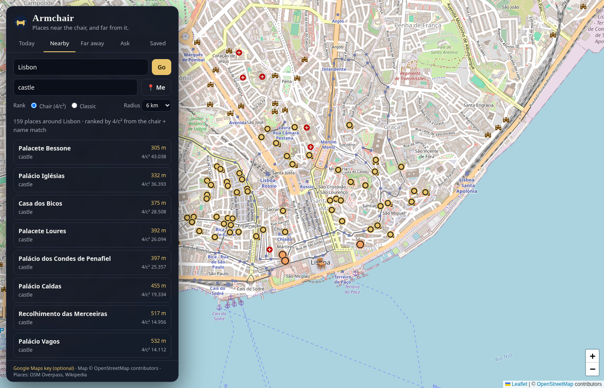

# Armchair

**Live:** https://fitzyracing1.github.io/armchair-atlas/ · **Repo:** https://github.com/fitzyracing1/armchair-atlas

A cinematic atlas for places near the chair and far from it. Static site, no build, **no API key**: Leaflet + OpenStreetMap tiles, Nominatim search, Overpass for places on the map, and Wikipedia for nearby articles and summaries. Google is optional.



## What it does

- **Today**: opens on a place of the day from the hand-picked atlas (40 places; Sep 18, 2026, the day the chat built it, is San Pedro de Atacama). Fly there or put the chair there.
- **Nearby**: share your location (📍 Me) or search any city. The chair (🪑) moves there and Armchair gathers attractions, museums, viewpoints, castles, ruins, peaks, beaches, waterfalls, parks… from **OpenStreetMap (Overpass)** plus **Wikipedia geosearch**, within 2–25 km. An optional "Looking for…" keeps only places whose name or kind matches (castle, beach, museum).
- **Ranking** (the chat's `4 / c²`):
  - **Chair**: `score = 4 / c² + name match`, with `c` = great-circle distance from the chair in km (floored at 50 m), name match ∈ [0, 1] (exact 1, prefix 0.75, substring 0.5, partial words). Nearer pins weigh more: twice as far is a quarter of the weight. The top three get highlighted pins; every row shows its score.
  - **Classic** ("save old version"): the original first-found merge: Wikipedia results first, then the map, duplicates dropped.
- **Far away**: mood chips (Quiet corners, Old stone, Edge of the map, Warm harbors, Ice and cold, Deserts at night, Strange earth), **🎲 Somewhere else** for a random leap, or the **full atlas**.
- **Ask**: tell the guide a climate, a kind of silence, a feeling ("somewhere cold and silent at the edge of the world", "a harbor at dusk"). It matches your words against the atlas and flies the map to real places (Point Nemo, Cape Horn, Fes medina, Valletta at dusk…).
- **Google, on any pin**: Google Maps, Satellite, Street View and Directions links (no key needed), plus OpenStreetMap. With an optional **Maps Embed API key** (footer → "Google Maps key", stored in the browser, or `?gmapsKey=`), pins also embed Google satellite.
- **Saved** places stay on the device (localStorage).
- Wikipedia summaries and photos load when you open a pin.

URL shortcuts: `?q=Lisbon&want=castle` runs a nearby search, `?ask=quiet+old+stone` asks the guide.

## Run it

```sh
python3 -m http.server 8080    # open http://localhost:8080 (ES modules need http://)
npm test                       # node --test: distances, 4/c², classic merge, guide, adapters
```

Deploy to GitHub Pages as-is: `.github/workflows/pages.yml` publishes the repo root on push to `main` (Settings → Pages → Source: GitHub Actions). Leaflet 1.9.4 is vendored in `vendor/leaflet` (BSD-2-Clause).

## Choices and limits

- The chat produced three zips (Classic, Chair rank, GitHub Pages). Here they are one app: Chair and Classic are a toggle and the whole thing is Pages-ready.
- The "agent"/guide is a local keyword matcher over the curated atlas. No LLM, so no key and no cost.
- Public Overpass/Nominatim/Wikipedia servers are rate-limited and occasionally slow. Armchair falls back to a second Overpass mirror and says which source did not answer. Nominatim is only called when you press Go.
- OSM tagging varies by city (in Lisbon many palaces are tagged `historic=castle`, as in the screenshot).

## Origin

Built from Joshua Almeida's Grok chat "Armchair Traveler AI Agent with Google Integration" (https://grok.com/c/b1d6f243-e65b-4a0a-9773-2b80581f7a8e, Sep 18, 2026). Note: a private repo `fitzyracing1/armchair` already exists, so this build is named `armchair-atlas`.

## License

MIT, see [LICENSE](LICENSE). Map data © OpenStreetMap contributors (ODbL). Wikipedia content CC BY-SA.
