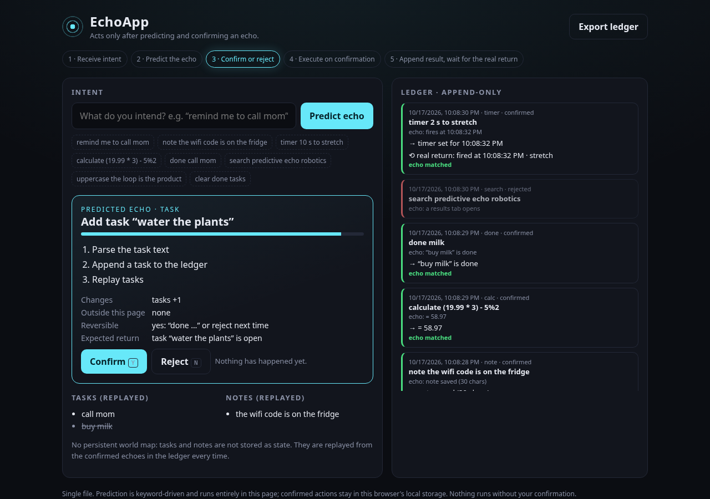

# EchoApp

**Live:** https://fitzyracing1.github.io/echoapp/ · **Repo:** https://github.com/fitzyracing1/echoapp

**A new type of application that only acts after predicting and confirming an echo.**

Traditional apps keep a world model and execute on input. EchoApp runs one loop:

1. **Receive intent**: you type what you intend.
2. **Predict the echo**: the action path, what changes, what leaves the page, whether it's reversible, and the expected return.
3. **Show it** for confirmation or rejection (buttons or `Y` / `N`).
4. **Execute only on confirmation.**
5. **Append the result** to the ledger **and wait for the real return**, then mark the echo *matched* or *diverged*.

No silent side effects. No persistent world map. The loop is the product.



## What it can do

All in one file, `echo-app.html` (open it in any browser, no server needed):

| Intent (examples) | Echo | Real return |
|---|---|---|
| `remind me to call mom`, `todo buy milk` | add a task | task is open |
| `done milk` | close the matching task (low confidence and disabled if none matches) | task done |
| `note the wifi code is on the fridge`, `forget note wifi` | keep / drop a note | note saved / removed |
| `timer 10 s to stretch`, `ping me in 5 min` | schedule a timer | arrives later, when it fires (notification if allowed) |
| `calculate (19.99 * 3) - 5%2` | safe arithmetic (a parser, never `eval`) | the number |
| `open example.com`, `search echo location` | open a tab (shows that data leaves the page) | tab opens / blocked |
| `copy hello` | write the clipboard (flagged irreversible) | clipboard result |
| `uppercase …`, `lowercase …`, `reverse …`, `slugify …`, `count words in …` | transform text | the text |
| `clear done tasks` | drop done tasks from the replay | count removed |
| `forget everything` | erase the ledger (red, irreversible, export first) | empty ledger |

Anything else predicts **no echo** and nothing can run.

- **Append-only ledger** of every intent, prediction, decision (confirmed *and* rejected), result and real return, in `localStorage`. **Export ledger** downloads it as JSON.
- **No persistent world map**: tasks and notes are never stored as state; they are **replayed** from confirmed ledger entries every render.
- Timers can't outlive the page; on reload any unfinished one is closed out as "lost" (diverged) instead of pretending.
- `?intent=…` in the URL pre-fills and predicts.

## Run / test

```sh
open echo-app.html                  # or: python3 -m http.server 8080 → /echo-app.html
npm test                            # node --test: loads the core straight out of echo-app.html via node:vm
```

GitHub Pages: `.github/workflows/pages.yml` deploys the repo; `index.html` redirects to `echo-app.html`.

## Choices

The chat produced `echo-app.html` + a short README whose contents aren't in the capture. This rebuild keeps that concept (single file, keyword prediction, local storage) and makes it concrete: a fixed set of safe, local effectors; predicted vs. real return matching; replay instead of state; keyboard confirm/reject.

## Origin

Built from Joshua Almeida's Grok chat "Create a new type of app" (https://grok.com/c/052f9308-43d7-4387-8aed-eb95f36503b9, ~Oct 11, 2026).

## License

MIT, see [LICENSE](LICENSE).
