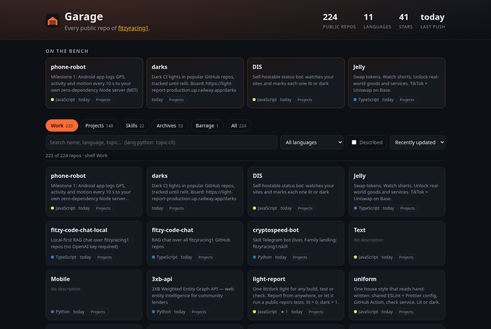

# Garage

**Live:** https://fitzyracing1.github.io/garage/ · **Repo:** https://github.com/fitzyracing1/garage

A public index of every public repository of the GitHub account **[fitzyracing1](https://github.com/fitzyracing1)**. Static site, no build, deployable to GitHub Pages.



## Features

- **Live data, client-side**: the browser pages through `GET /users/fitzyracing1/repos` on the GitHub API (unauthenticated, ~3 requests), caches the result in `localStorage` for an hour, and falls back to the bundled `data/snapshot.json` if the API is rate-limited or offline. Private repos never appear (the public endpoint cannot see them).
- **Shelves**: Work (default: everything except Barrage clones, so they don't bury the rest), Projects, Skills, Archives, Barrage, All, each with a count.
- **Search** by name, description, language or topic, with `lang:python` and `topic:cli` operators. Press `/` to focus search.
- **Filter** by language or "Described" (only repos with a description). **Sort** by updated, created, stars or name.
- **Repo drawer**: dates, stars, forks, branch, license, homepage, topics (click a topic to search it) and a link to GitHub.
- **On the bench**: the latest projects that actually describe themselves.
- State lives in the URL hash (`#shelf=Skills&q=grok`, `#repo=uiltiol`), so views are linkable. `?user=<login>` indexes any other account; `?refresh` skips the cache.

## Run it

```sh
python3 -m http.server 8080   # then open http://localhost:8080
npm test                      # node --test, no dependencies
npm run snapshot              # refresh data/snapshot.json (GITHUB_TOKEN optional)
```

Deploy: `.github/workflows/pages.yml` publishes the repo root to Pages on push to `main` (Settings → Pages → Source: GitHub Actions). `.nojekyll` is included.

## Shelf rules (choices made)

The chat named the shelves but not how repos land on them, so `src/garage-core.js` uses:

| Shelf | Rule |
|---|---|
| Barrage | name ends in `-barrage`, or description says "Barrage plain-language clone" |
| Skills | name starts with `skill-`/`skills-`, or description starts "Grok skill"/"Claude skill" |
| Archives | forks, archived repos, names with `log`/`archive`/`snapshot` segments, "combined snapshot"/"my clone" descriptions |
| Projects | everything else |
| Work | all but Barrage |

The chat counted 594 public repos (351 Work / 243 Barrage); on Oct 17, 2026 the API reports 224 public repos, so the live counts differ.

## Origin

Built from Joshua Almeida's Grok chat "Create a site for all of my repos" (https://grok.com/c/91967971-7580-483f-90f4-18a2f8daca38, Oct 2, 2026).

## License

MIT, see [LICENSE](LICENSE).
